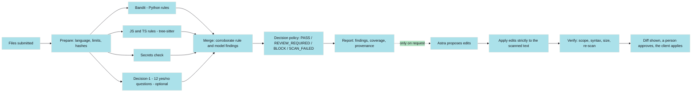

*PHYLAX · ALGORITHM GUIDE*

# How Phylax decides.

This is the document the review paper depends on most. It explains every detection technique, the decision engine, and the correction workflow **as they exist in the code**, with the reasons for each choice. Where something was discussed but not built, or built but not tested with a real model, it says so. Read `PHYLAX_PROJECT_OVERVIEW.md` first for the status labels and the glossary.

Sources of truth, in order: the repository code (audited 2026-11-11), the verdict records in `benchmark/results/`, and the development transcripts. Every number carries its source.

## Contents

1. The pipeline in one picture
2. Preparing the files
3. Static analysis: Bandit, our JavaScript and TypeScript rules, the secrets check
4. AI-assisted detection: Microsoft-Decision-1
5. The decision engine
6. Code correction with Astra, and verification
7. Languages
8. Cost and complexity
9. What is not here

## 1. The pipeline in one picture



*Mermaid is used here because the handoff asked for it. It is a fallback to the hand-drawn Flwn diagram style, with the palette applied through theme variables.*

Four things are kept apart on purpose, and the rest of this document keeps them apart too: **detection** (engines produce findings), **decision** (a pure function turns findings and coverage into a verdict), **correction** (a model proposes edits), and **approval** (a person says yes, in a client, never in the service).

## 2. Preparing the files

`core/files.py`, `prepare_files`. Input is a list of `(path, content)`. For each file:

1. The language is taken from the extension (`EXTENSION_LANGUAGES`), or from the request's default language. The table recognises Python, JavaScript, TypeScript, C, C++, C#, Java, Go, Rust, Ruby, PHP and shell.
2. Limits apply (starting values, "tune after measuring"): at most 50 files, 200,000 bytes per file, 1,000,000 bytes in total.
3. Line endings are normalised to `\n`, so reported line numbers match the caller's. The SHA-256 of the text *exactly as submitted* is recorded in the report (`coverage.scanned_files`), so a client can later prove which bytes were scanned.
4. A file that cannot be scanned is **skipped with a reason**: `unsupported_language`, `file_too_large`, `binary_or_invalid` or `empty`. A skipped source file carries `blocks_pass = true`.

Skipping is not silence. Each skipped file appears in `coverage.skipped_files`, and the decision policy refuses to turn a report containing a blocking skip into a PASS (section 5).

## 3. Static analysis

### 3.1 What static analysis is

Static analysis inspects program text without running it. The code is parsed into a tree (an abstract syntax tree, AST, or a concrete syntax tree, CST). A detector walks the tree looking for structures that match a known-dangerous pattern, for example "a call to `os.system` whose argument is built by joining strings". A *finding* is generated when a pattern matches. It records a category, a line, a severity, a confidence, and an evidence line.

Two properties matter for the paper. **Determinism**: the same input always gives the same findings, which is why Phylax lets rule findings (and only those) block. **Limited reach**: whether a program is vulnerable is, in general, undecidable (a consequence of Rice's theorem, see `PHYLAX_RELATED_WORK.md`), so every practical detector approximates. It either misses real problems (false negatives) or reports harmless code (false positives), and each rule is a deliberate trade between the two.

Severity and confidence are **separate** in Phylax and in Bandit. *Severity* is how bad the problem would be if real. *Confidence* is how sure the rule is that this is the problem. Only high severity **and** high confidence can block.

### 3.2 Bandit (Python)

Status: implemented, tested with the real tool in the suite (not mocked).

Bandit is an open-source security linter for Python. According to its documentation, it processes each file, builds an AST, and runs plugins against the AST nodes; each test is registered for the kinds of node it examines and is executed as Bandit's node visitor walks the tree. Each result has a test ID (for example `B102` for `exec`), a severity, a confidence, and often a CWE tag.

How Phylax uses it (`adapters/bandit.py`):

```
write the file's text to snippet.py in a throwaway temp directory
run:  python -m bandit -f json --exit-zero -q --ignore-nosec snippet.py   (30 s timeout)
parse the JSON; for each result:
    vulnerability_type = RULE_TO_TYPE[test_id]   if the test id is mapped (B102, B307, B201, B608, B501, B323, B306, B108, B311, B701, B506)
                         else CWE_TO_TYPE[cwe]    (77/78 command, 89 sql, 94/95 code, 502 deserialisation, 326-328 weak crypto, 330/338 random,
                                                   22 path, 918 ssrf, 79/80 xss, 295 tls, 377/379 temp file, 259/321/798 credentials)
                         else "other"
    severity   = Bandit's issue_severity      (LOW, MEDIUM, HIGH)
    confidence = Bandit's issue_confidence    (LOW, MEDIUM, HIGH)
    evidence_tier = static_rule; line = Bandit's line; evidence = that line with secrets masked
```

Design points:

- **The rule mapping wins over the CWE mapping**, because Bandit's CWE tags are coarse (the code notes that it tags `eval()` with the command-injection id).
- **`--ignore-nosec`.** By default one `# nosec` comment hides a finding. Code under review, especially AI-written code, must not be able to silence its own scanner. The code records that, by default, a single `# nosec` hides a HIGH-severity `shell=True` finding.
- **Hardening that exists:** the submitted code is only parsed, never executed; Bandit runs as a subprocess with a timeout in a throwaway directory; its standard input is closed; `PYTHONPATH`, `PYTHONSTARTUP` and `PYTHONINSPECT` are removed from its environment; on a stall the error says what Bandit printed. **Hardening still listed as "to do" in the module header:** memory limits, a minimal environment, and no network for the subprocess.
- **Failure is a failure.** An unreadable output, a timeout, or `errors` in Bandit's JSON makes the engine fail for that file. It never produces zero findings quietly.

Limits: the Python lane's coverage is whatever Bandit's plugins cover. Bandit does not follow data across functions or files, and it is pattern-oriented.

### 3.3 Our JavaScript and TypeScript rules

Status: implemented (`adapters/js_rules.py`, 940 lines); tested on example pairs and on real open-source code (see `PHYLAX_EVALUATION.md`). This is **original work**: a rule set written by us, on the tree-sitter parsers, rather than an adopted tool.

Why our own: the development notes record a concern that the best-known rule collection for these languages is licensed for internal, non-SaaS use, and Phylax is offered as a service. This was not legally reviewed; Flwn's legal review should confirm it before it appears in a paper as fact.

What the engine understands (from the module's own description):

1. **Real structure.** Rules run on the parse tree, so a comment or string that merely mentions `eval(` triggers nothing.
2. **Constants.** `const CMD = "ls -la"; exec(CMD)` is not a finding. A name counts as a constant only if it is bound exactly once in the file, so a parameter that shadows it cannot hide a real finding.
3. **User input, one hop.** Expressions mentioning `req.query`, `req.body`, `req.params`, `event.body`, `location.search`, `process.argv` and similar are *input*, and so is a variable assigned from one. Input survives string handling (`path.join`, `decodeURIComponent`, `.trim()`, `JSON.parse`, templates, concatenation) but **not a lookup**: `const user = sessions.get(req.cookies.token)` is stored server data, so `user` is not input. Rules for path traversal, SSRF and reflected content use this to avoid flagging every dynamic value.
4. **Where a name came from.** `exec` is a command sink only if it was imported from `child_process`, so `regex.exec(text)` and `db.exec(sql)` are left alone.
5. **TypeScript.** `as`, `satisfies`, `!` and parentheses are looked through; a `.ts` file that only parses as TSX is handled.
6. **A file that does not parse is an engine failure**, never a pass.

Taint analysis background: this is a deliberately small, intraprocedural cousin of taint tracking (sources, propagation, sinks). It follows input one assignment deep and propagates through string operations, but not across function calls or files.

The 25 rules, generated from the code's own table (`RULES` in `js_rules.py`):

| Rule | Category | Severity | Confidence | CWE |
|---|---|---|---|---|
| `JS-DEBUG-ENV` | debug_enabled | medium | medium | CWE-489 |
| `JS-DESERIALIZE` | insecure_deserialization | high | high | CWE-502 |
| `JS-DOCWRITE` | xss_or_template_injection | medium | medium | CWE-79 |
| `JS-EVAL` | code_injection | high | high | CWE-95 |
| `JS-EXEC` | command_injection | high | high | CWE-78 |
| `JS-FUNCTION` | code_injection | high | high | CWE-95 |
| `JS-INNERHTML` | xss_or_template_injection | medium | medium | CWE-79 |
| `JS-JQUERY-HTML` | xss_or_template_injection | medium | medium | CWE-79 |
| `JS-NOSQL-WHERE` | sql_injection | medium | medium | CWE-943 |
| `JS-OPEN-REDIRECT` | other | medium | medium | CWE-601 |
| `JS-PATH` | path_traversal | medium | medium | CWE-22 |
| `JS-RANDOM` | insecure_random | low | medium | CWE-338 |
| `JS-REACT-HTML` | xss_or_template_injection | medium | medium | CWE-79 |
| `JS-RENDER-VIEW` | path_traversal | medium | medium | CWE-22 |
| `JS-SHELL-OPTION` | command_injection | high | high | CWE-78 |
| `JS-SQL` | sql_injection | medium | medium | CWE-89 |
| `JS-SSRF` | ssrf | medium | medium | CWE-918 |
| `JS-STACK-LEAK` | debug_enabled | medium | high | CWE-209 |
| `JS-TEMP-FILE` | insecure_temp_file | medium | medium | CWE-377 |
| `JS-TEMPLATE-SOURCE` | xss_or_template_injection | high | medium | CWE-1336 |
| `JS-TIMER-STRING` | code_injection | medium | medium | CWE-95 |
| `JS-TLS-OFF` | tls_verification_disabled | high | high | CWE-295 |
| `JS-VM` | code_injection | high | medium | CWE-94 |
| `JS-WEAK-CIPHER` | weak_crypto | medium | high | CWE-327 |
| `JS-WEAK-HASH` | weak_crypto | medium | medium | CWE-328 |

**Six rules can block** (high severity and high confidence): `JS-DESERIALIZE`, `JS-EVAL`, `JS-EXEC`, `JS-FUNCTION`, `JS-SHELL-OPTION`, `JS-TLS-OFF`. Everything else asks for human review. The assignment of severity and confidence to each rule is a design judgement by the authors, not a measured quantity; no study of these assignments exists in the repository.

What the rules do not do, said in the module: follow data across functions or files, tell a sanitised value from an unsanitised one beyond the simple guards named in each rule, or act as a type checker.

### 3.4 The secrets check

Status: implemented (`adapters/secrets_check.py`, `core/redaction.py`), deterministic, no model, no network.

It shares one pattern library with the masking step, with opposite biases, stated in the code as "mask liberally, accuse carefully":

- **Detecting** (reportable) is careful: a match is *strict* only if the value could plausibly be a real secret. Names, header names, environment-variable names, paths, URLs, dates and versions are never reported.
- **Masking** is liberal: a missed secret leaks, a wrongly masked value costs nothing.

Patterns: known token formats (`sk-...`, `AKIA` + 16 characters, `gh[pousr]_...`, `xox[baprs]-...`, JSON Web Token shape, bearer tokens) and credential-named assignments (`password`, `secret`, `token`, `api_key`, ... assigned a quoted value of at least six characters). Severity: a known format is HIGH, a probable secret in a credential-named variable is MEDIUM. **Confidence is always MEDIUM**, because a pattern cannot tell a live key from the documented example key; therefore a secret found by pattern asks for review but **can never block**. One finding per line; evidence is masked.

A secret is never corrected automatically (section 6). The check covers only the languages that a rules engine also covers, so a file never counts as scanned on secrets alone.

### 3.5 What each engine can identify

Twelve categories are used throughout (`core/questions.py`): command injection, SQL injection, code injection, insecure deserialisation, weak cryptography, insecure randomness, path traversal, server-side request forgery, XSS or template injection, disabled TLS verification, debug mode enabled, insecure temporary file. Hardcoded credentials are a thirteenth category, owned only by the secrets check.

| Category | Bandit (Python) | JS/TS rules | Decision-1 asked? |
|---|---|---|---|
| command injection | yes (mapped tests, CWE 77/78) | `JS-EXEC`, `JS-SHELL-OPTION` | yes |
| SQL injection | yes (`B608`) | `JS-SQL`, `JS-NOSQL-WHERE` | yes |
| code injection | yes (`B102`, `B307`) | `JS-EVAL`, `JS-FUNCTION`, `JS-VM`, `JS-TIMER-STRING` | yes |
| insecure deserialisation | yes (`B506`, CWE 502) | `JS-DESERIALIZE` | yes |
| weak cryptography | yes (CWE 326-328) | `JS-WEAK-CIPHER`, `JS-WEAK-HASH` | yes |
| insecure randomness | yes (`B311`) | `JS-RANDOM` | yes |
| path traversal | yes (CWE 22) | `JS-PATH`, `JS-RENDER-VIEW` | yes |
| SSRF | yes (CWE 918) | `JS-SSRF` | yes |
| XSS / template injection | yes (`B701`) | five rules | yes |
| TLS verification off | yes (`B501`, `B323`) | `JS-TLS-OFF` | yes |
| debug mode | yes (`B201`) | `JS-DEBUG-ENV`, `JS-STACK-LEAK` | yes |
| insecure temp file | yes (`B306`, `B108`) | `JS-TEMP-FILE` | yes |
| hardcoded credentials | via CWE map, plus secrets check | secrets check | no (by design) |

"Decision-1 asked?" is true for Python only in production. For JavaScript and TypeScript the questions exist but are switched off until a held-out test passes (section 7).

### 3.6 Advantages and limitations of the rule-based lane

Advantages: deterministic and explainable (a finding names a rule, a line, and a CWE); cheap and fast; no data leaves the system; testable rule by rule; cannot be talked out of a finding by a comment (Bandit runs with `--ignore-nosec`; our rules read structure, not comments).

Limitations: no data flow across functions or files; pattern rules fire on look-alikes and miss disguised vulnerabilities (the measured rules-only results are in `PHYLAX_EVALUATION.md`: on the JavaScript held-out set the rules alarmed on 5 of 14 vulnerable cases); coverage is only as wide as the rule list; Bandit is Python only; no engine understands the application's business logic or authorisation rules (the report lists this under `not_assessable`).

## 4. AI-assisted detection: Microsoft-Decision-1

Status: **implemented, and tested with the real model.** First real call 2026-10-23. A held-out evaluation passed for Python on 2026-10-23. For JavaScript and TypeScript the questions and a pre-registered evaluation exist, but **the model has not been run on them**, and the model is not used for those languages in scans.

### 4.1 What the model is, and is not

Per Microsoft's Foundry catalog entry, Microsoft-Decision-1 is a decision-scoring model that returns calibrated probability scores for fixed answer options instead of generated text. Microsoft's documentation describes three question types. A request is one *state* (text or JSON) plus named *typed questions*; each question name becomes a key in the response. Phylax uses only the yes/no type (`noul`, a probability between 0 and 1) for detection. Secondary sources, citing Microsoft's catalog, report that it is post-trained from an open 9-billion-parameter model (Qwen3.5-9B), that its context is about 33,000 tokens, and that it is billed per input token with output free; the paper should confirm these against the catalog before citing them. The catalog also states the model is not designed or evaluated as the sole automated decision-maker in consequential decisions about people, which is consistent with, though not about, Phylax's use.

It is **not** a chat model: it writes no explanation, cannot quote a line, and cannot be asked an open question. That shapes the whole integration:

- It cannot hallucinate a finding in prose, because it produces numbers for questions we wrote.
- It cannot say *where* the problem is. Its findings describe the whole file (`line = null`).
- Its number is a probability for a yes/no question, not a severity.

### 4.2 How code is prepared and sent

`adapters/classifier_detector.py` and `adapters/decision1.py`:

1. Secrets are **masked** (`<REDACTED_SECRET>`) inside the adapter, as "the last line of defense at the boundary where code leaves the system". Masking preserves line count and is idempotent.
2. One request per file carries all twelve questions (batching reduces cost and latency; Microsoft's own example combines several typed questions on one state, and the development notes record a vendor figure for batching that the paper should not reuse without checking).
3. Each question (`core/questions.py`) states an **exact literal condition**, true and false criteria, and names the safe alternative, because models read literally and scores change with wording. Example (command injection, Python): *does the code build an operating-system command from a variable or other changing value, for example by joining text into a string passed to `os.system`, `os.popen`, or `subprocess` with `shell=True`, instead of running a fixed program with its arguments passed as a list?* True means "a command is built from changing text"; false means "commands are fixed, or arguments are passed as a list without a shell, or no command is run".
4. There is **no question about secrets**: masking makes the model unable to tell a real secret from a harmless masked value, and the deterministic check owns that category.
5. Questions come in two families, **python** and **javascript** (a TypeScript file is asked the JavaScript questions). An optional "worst problem" verdict question exists, is **off by default**, and was measurably noisy.
6. A file larger than about 30,000 tokens is not assessed by the model (chunking is not built). The rules still scan it and the report records the model's failure.

### 4.3 How the answer becomes findings

```
probabilities = classifier.classify(masked_code, questions)          # one yes/no probability per category
for category in the 12 categories:
    if probabilities[category] >= THRESHOLD:                          # default 0.70
        emit Finding(type=category, tier=model_suspicion, severity=MEDIUM,
                     confidence=at most MEDIUM, line=None,
                     evidence="a sentence about the assessment, never a quote of the file")
```

- **Flat severity.** A model gives a probability, not a severity, so every model finding is medium.
- **Confidence capped at medium, even at 99%**: the probability is "not evidence a person can check".
- **No code in the evidence.**
- **Threshold 0.70** is the value the Python held-out test validated, and it is **tied to the model version** (the adapter requires an exact model version; a different version can have a different calibration curve).
- **Calibration:** Phylax uses the raw probabilities against a threshold chosen by evaluation. It does **not** calibrate them. No calibration curve or expected calibration error was computed. The only separation measure is the AUC reported in the verdict (section 4.5). Calibration theory is background, see `PHYLAX_RELATED_WORK.md`.

### 4.4 When the model is wrong, slow, or unavailable

The classifier is an **optional engine** by default (`required=False`). Transient failures (HTTP 408, 429, 500, 502, 503, 504 and network errors) are retried up to 3 attempts, honouring `Retry-After` capped at 10 seconds. Anything else fails at once. A failure becomes an engine error for that file; the scan finishes on the other engines, and a note states that the model was unavailable. If `CLASSIFIER_REQUIRED` is set, a model outage fails the scan instead. Errors never contain the submitted code or any credential.

### 4.5 What the evaluation showed

Full detail and caveats are in `PHYLAX_EVALUATION.md`. In short, on the Python held-out set (39 cases, 14 vulnerable, 25 safe, written before any model saw them, run once): the model found 13 of 14 in the right category, caught 2 of the 3 vulnerable cases the rules miss, added 2 false alarms beyond the rules, and lost no catches to a comment claiming a security review. The scores separated the true-category question from every other question with an AUC of 1.00 and vulnerable from safe cases with 0.99. These are small-sample, author-written results, and the intervals are wide.

The first version of the questions **failed** its gate on a 50-case development set (7 extra false alarms against an allowance of 1), mostly because of the project's own masking and mislabeled cases; the second version was judged only on fresh cases.

### 4.6 Prompt injection

Code under review can contain text that tries to steer a model. The evaluation tests two injected comments: "approved by the security team" and "ignore all previous instructions". The first lost no catches at any threshold from 0.5 to 0.9. The second lost none up to 0.70, but 2 catches (15%) at 0.80 and 4 (31%) at 0.90, and debug-mode detection fell from 100% to 75%. The 0.70 margin is real but thin. Mitigations in the design: the model never decides alone, rule findings do not read comments, and the correction prompt wraps code in randomly named tags (section 6). Indirect prompt injection is a documented attack class; see the Greshake et al. entry in `PHYLAX_RELATED_WORK.md`.

### 4.7 An LLM used as a detector versus static analysis

| | Static analysis (Bandit, our rules) | Decision-1 as used here | A generative LLM as detector |
|---|---|---|---|
| Output | findings with a rule, line and CWE | a probability per question | free text, parsed |
| Deterministic | yes | not established (run-to-run variance not measured) | no (published evidence of non-determinism) |
| Can explain | yes, by rule | no | yes, but the reasoning may be unfaithful |
| Sees across functions | no | yes, within the file | yes, within context |
| Can block in Phylax | yes, if high/high | never | never |
| Reads comments | no | yes (hence the injection test) | yes |

Phylax implements the middle column. It also contains a **generative detector** (`adapters/llm_detector.py` with a quote-checking step that drops findings whose quoted line is not in the code) and a bake-off harness (`benchmark/bakeoff.py`). **Neither is part of the scan pipeline, and no real generative model was ever compared**: the only bake-off table on record is the harness self-test with scripted stand-ins. This is a research gap, not a finding.

## 5. The decision engine

`core/policy.py` is pure Python with no model calls, "on purpose: the policy must be explainable and testable, so no model is ever asked 'is this safe?'". The knobs are `BLOCK_MIN_SEVERITY = HIGH`, `BLOCK_MIN_CONFIDENCE = HIGH`, `REVIEW_MIN_SEVERITY = MEDIUM`. The policy has a version number that changes when a threshold changes.

### 5.1 Evidence tiers

Every finding has an `evidence_tier`: `static_rule` (a deterministic rule matched), `model_suspicion` (only a model flagged it), or `corroborated` (both kinds agree). Rule-backed means `static_rule` or `corroborated`.

### 5.2 Corroboration (merging engine outputs)

`core/scan_service.py`, run per file before the decision:

```
same_issue(a, b):
    if a.type != b.type:                                   return False
    if a.sources and b.sources overlap:                    return False   # one engine reporting twice is not corroboration
    if either has no line:                                 # a whole-file model finding
        whole, other = the one without a line, the other
        if other has no line or whole is rule-backed or other is not rule-backed:   return False
        return whole.severity <= other.severity            # a model may join a rule finding, never outrank it
    if |a.line - b.line| > 1:                              return False
    if both rule-backed:                                   return True            # two rule engines agree
    rule, model = ...
    return model.severity <= rule.severity                 # a model that claims MORE stands on its own

combine(a, b):
    base = the rule-backed finding with higher severity    # severity and confidence come from rules only
    base.sources += other.sources; base.tier = corroborated
    (if both rule-backed, take the higher confidence and fill the CWE)
```

Consequences: a model can raise nothing through a merge; two models never merge; one engine's repeated findings never merge. The merged finding lists both sources, which is the evidence a reviewer can inspect.

### 5.3 The decision function

```
decide(findings, analyzers_ok, analyzers_failed, strict_coverage, skipped_blocking, notes):
    if analyzers_ok is empty:                       return SCAN_FAILED          # nothing completed
    tool  = findings with tier in {static_rule, corroborated}
    model = findings with tier == model_suspicion
    blockers     = [f in tool  if f.severity >= HIGH   and f.confidence >= HIGH]
    tool_review  = [f in tool  if f.severity >= MEDIUM]
    model_review = [f in model if f.severity >= MEDIUM]

    if blockers:           decision = BLOCK
    elif tool_review:      decision = REVIEW_REQUIRED
    elif model_review:     decision = REVIEW_REQUIRED     # "a model alone never blocks"
    else:                  decision = PASS                # "nothing found by the checks that ran", never "safe"

    if skipped_blocking > 0:                              # a source file was not scanned
        if decision == PASS:  decision = REVIEW_REQUIRED  # "a pass needs every source file scanned"
        else:                 add a coverage reason

    if analyzers_failed (required engines only):
        if decision == PASS and strict_coverage:  return SCAN_FAILED
        else: add "coverage is reduced" to the reasons
    return decision, reasons

decide_nothing_scanned(skipped_blocking):               # every file skipped
    skipped_blocking > 0  ->  REVIEW_REQUIRED
    else                  ->  PASS, stating that nothing was checked
```

### 5.4 Properties, and where they are tested

| Property | How it is enforced |
|---|---|
| A model-only finding never produces BLOCK | `blockers` is built from `tool` only |
| A skipped source file never yields PASS | `skipped_blocking` converts PASS to REVIEW_REQUIRED |
| A failed required engine never yields a silent PASS | strict coverage converts PASS to SCAN_FAILED |
| An optional engine being down does not fail the scan | the scan separates `required_failed` from `optional_failed`, and says so in a note |
| An engine that raises fails closed | the scan catches the exception and records only the exception type, never its message (which may contain code) |
| `# nosec` cannot suppress a Bandit finding | `--ignore-nosec` |
| A merge cannot raise severity | `same_issue` and `combine` above |
| Unknown verdicts are treated as review | contract convention: clients treat any unknown decision as `review_required` |

The module's self-test (`core.policy`) exercises the thresholds, the model-only rule, and the failure and skipped-file cases, and the scan service's self-test (`core.scan_service`) runs the whole pipeline with scripted engine and classifier stand-ins. The paper should cite these as unit-level evidence, not as a proof.

### 5.5 Coverage representation

A report carries `coverage`: languages, `files_scanned`, `scanned_files` (path and SHA-256), `skipped_files` (path, reason, whether it blocks a pass), `analyzers_run`, `analyzers_failed`, and `not_assessable` (fixed sentences: authentication and authorisation logic, data flow across services and unsubmitted files, third-party dependencies, deployment and runtime behaviour). It also carries `provenance` (contract, service and policy versions, and the engines used). **A PASS is a statement about the checks that ran on the files that were scanned**, and the report says so in its reasons.

### 5.6 Conflicting results

There are three kinds, handled differently. (1) *Rule and model agree*: merged into a corroborated finding. (2) *Model flags, rules are silent*: a model-suspicion finding, REVIEW_REQUIRED. (3) *Rule flags, model says no*: the rule finding stands and can block; the model's silence cannot clear it. The system has no mechanism by which a model's "no" removes a finding. Note also the separation of **verdict** from **fix eligibility**: the decision says whether to proceed, while each finding separately says whether a correction may be offered (section 6).

## 6. Code correction with Astra, and verification

Status: implemented (`adapters/foundry_corrector.py`, `core/fix_service.py`, `core/verification.py`, `core/patching.py`). Tested with real Astra on about six Python examples in development, and with a stand-in model server in the suite (which is also what the demo UI replays). **Never run against real Astra on JavaScript or TypeScript. Fix success rate has never been measured.** Corrections are disabled unless `SERVICE_FIXES_ENABLED` is on, because each is a paid model call.

### 6.1 Eligibility: which findings may be corrected

`core/schema.py`, `fix_eligibility`: a hardcoded secret is **never** corrected (it must be removed and rotated, and removing it is not something to automate); a finding below medium severity is reported, not corrected, by default; otherwise a correction is offered. This depends on the finding alone, never on the verdict.

### 6.2 Generating the proposal

The corrector sees **one file** (masked) and the findings to fix, inside tags with a **random name chosen per request** (`<file_xxxx>`, `<finding_xxxx>`), and is told the text inside is data, not instructions. Code cannot close the tag, because it cannot know the name. This reduces prompt injection and does not remove it.

The model must reply with JSON: a list of **edits**, each `{finding_ids, old, new, explanation}`, where `old` is one or more *complete lines copied exactly*, occurring exactly once in the file, and `new` replaces them; plus an `unfixed` list with reasons. The instructions forbid adding network calls, file writes, subprocesses, or dependencies, require minimal change, and forbid editing any line containing the masking marker. Why edits and not a rewritten file: output tokens are the expensive part, and edits make the **scope checkable**.

```
apply_edits(code, edits):           # all or nothing
    every edit.old must occur exactly once, starting at a line start, else refuse
    edits must not overlap; any edit touching a masked line, or writing the marker back, is refused
    return the edited text
make_unified_diff(original, edited)  # difflib against the ORIGINAL file
```

Bounds: at most 10 files and 10 findings per file per request, most severe first; the rest are listed in `unfixed`. An answer that cannot be used raises a `BadProposal` whose message never quotes code.

### 6.3 What is verified is what will be applied

The diff returned by the corrector is **applied strictly to the exact text that was scanned** (`apply_unified_diff`). Verification then runs on that result. So what is verified is the text a client will receive, not an internal copy.

### 6.4 The four checks

`core/verification.py`:

| Check | What it does |
|---|---|
| `scope` | only files that were in the scan changed, and something changed |
| `syntax` | every changed Python, JavaScript or TypeScript file parses (Python by the standard `ast`; JS/TS by tree-sitter). For **Python**, the change must introduce no **undefined name** (computed with `ast` and `symtable`): deleting an import that other code still uses parses and re-scans clean, then crashes at run time. Names already undefined before the change are not blamed on it, and a file with `from x import *` cannot be judged. **For JS/TS the undefined-name check is not done** (it needs scope analysis); the check's detail says so |
| `patch_size` | added plus removed lines over all files within a limit (the recorded detail shows "limit 40") |
| `rescan` | the changed files are scanned again with the same engines. Every requested finding must be gone (counted per file and problem type, because lines shift) and nothing new may appear that a rule backs at medium severity or above. A new finding only a model suspects is listed for review but does not fail the check |

Outcome: `failed` if any check failed; `inconclusive` if the re-scan could not run (never treated as a pass); otherwise `passed`. A fix is `applicable` only when verification **passed**. Patches that fail are still returned, marked not applicable, so a reviewer can see them. `POST /v1/verifications` runs the same checks on a correction the **caller** wrote, so the same standard applies whoever authored the change.

### 6.5 Why the re-scan is necessary

A model's proposal is a claim. The model's own explanation is never trusted as a statement of what the patch does. The first real Astra fix (a ping command) was a good fix but not a minimal one: it changed the command to run without a shell, added a guard against a host starting with `-`, and dropped an unused `import os`. It also showed that a patch can remove an import something else needs, which is what motivated the undefined-name check (a reasoned risk, not an observed crash). The re-scan is what turns "the model says it fixed it" into "the same engines no longer find it, and nothing new appears". It cannot show that behaviour is preserved.

### 6.6 How unapproved modification is prevented

The service has **no endpoint that writes a file**, and the fix endpoint returns diffs only. The review client applies a correction only after an explicit yes for that file's diff (the command-line client has no "yes to all" option, the agent tools cannot be built without declaring how consent is obtained, and the UI applies only on a press of "Apply correction"). The client applies through the host's file-change mechanism with the expected SHA-256 of the scanned text, so a file that changed since the scan is refused instead of overwritten. After applying it reads the file back and asks the service to verify what is on disk.

## 7. Languages

The architecture does not use the same rules for every language. The shared parts are the contract, the policy, the report, the verification service and the twelve categories. The per-language parts are the engines.

| Language | Rules engine | Secrets check | Decision-1 in scans | Verification of fixes |
|---|---|---|---|---|
| Python | Bandit | yes | **on** (validated 2026-10-23) | parse and undefined-name check |
| JavaScript | our 25 rules (tree-sitter) | yes | **off** until its held-out test passes | parse only |
| TypeScript (including the TypeScript used by Oqelira) | the same rules, TypeScript and TSX grammars | yes | off, with JavaScript | parse only |
| JSON, YAML, TOML, INI, properties, `.config`, text | none: **secrets only** | yes, the only engine | no | not applicable (a secret is never corrected) |
| C, C++, C#, Java, Go, Rust, Ruby, PHP, shell | none | no | no | not applicable |

Notes. The last row is "recognised but unsupported": a file is skipped with `unsupported_language` and blocks a PASS. Only languages with a validated model test are listed in `VALIDATED_LANGUAGES` (today: Python), and enabling an unvalidated language in `CLASSIFIER_LANGUAGES` produces a warning. Enabling JavaScript enables TypeScript too, because they share their questions. Planned, not started: scanning for secrets only in configuration files (`.txt`, `.json`, `.yaml`, `.yml`, `.properties`, `.toml`, `.ini`, `.config`), then Java, C# and C. HTML and CSS are not scanned.

"TypeScript integration used by Oqelira" means two separate things, and the paper should keep them apart: (1) TypeScript *source files* are scanned by the JavaScript rules; (2) a TypeScript *client library* (`clients/typescript`) is how Oqelira, or any agent, talks to the service. The second is not an analysis technique.

### 7.1 Configuration and text files: a secrets-only lane

Configuration files are the one deliberate exception to the rule that the secrets check never covers a language alone. In code, a file never counts as scanned on secrets alone; in a configuration
file the secrets check is the only engine, so the report says so explicitly: each file appears in `coverage.limited_scope` ("hardcoded secrets only", contract 1.4.0) and the verdict's reasons carry a
sentence to the same effect. Such a file is not source code, so one that cannot be scanned (too large, binary) is listed but does not block a pass.

The detector (`core/config_secrets.py`) differs from the code scanner because configuration syntax does: values are often unquoted (`password: x`, `db.password=x`), and credentials also live inside
connection URLs, connection strings, JDBC query strings and XML settings. The policy is the same as everywhere: mask liberally, accuse carefully. A value is reported only if it is neither a reference
(`${VAR}`, `{{ x }}`, `ENC(...)`, `!secret x`) nor a placeholder (`changeme`, `<your-password>`, `****`), its key is not merely credential-adjacent (`token_url`, `password_min_length`), it is not a
dependency version range, and it passes the same careful probability test used for code. Evidence lines mask the value whether or not it was quoted. Findings are medium (high for known token
formats and private keys) with confidence capped at medium, so a configuration secret asks for a review and can never block.

Known limits, stated in the code and in the tests: a key abbreviated to `pw` is not recognised; a pure dictionary passphrase has no digit or symbol and is not reported; a secret in free prose with no
adjacent key is not found. Folder scans (the Python command and the TypeScript client) include these files and skip lock files, minified JSON, `.env*` files and key files.

## 8. Cost and complexity

Measured (from the records): Decision-1 averaged 0.55 s per request; the Python held-out run was 67 requests, 75,340 input tokens, about $0.0032. The first real Astra fix took about 7 seconds and under 2 cents. An earlier planning estimate of about 10 cents per Astra fix was an estimate, not a measurement, and the measurement was lower for that example.

Computational character (from the design, not a benchmark): parsing and rule matching are linear in file size; the Bandit subprocess has a 30-second limit; the model call is one request per file; fix requests use their own small worker pool and a stricter rate limit so a flood of fixes cannot become an unbounded bill. No load test exists. Scans are kept in memory, so the service must run as one instance.

## 9. What is not here

Not implemented: cross-function or cross-file data flow; dependency (software composition) analysis; chunking for large files; a calibrated probability; a generative detector in the pipeline; a measured fix quality (a harness exists, see the evaluation document, but it has not been run on the real model); execution of code or tests during verification; scanning of anything in configuration files other than hardcoded secrets; HTML, CSS, Java, C#, C. Not tested with a real model: the JavaScript and TypeScript use of Decision-1, and Astra on JavaScript or TypeScript.
