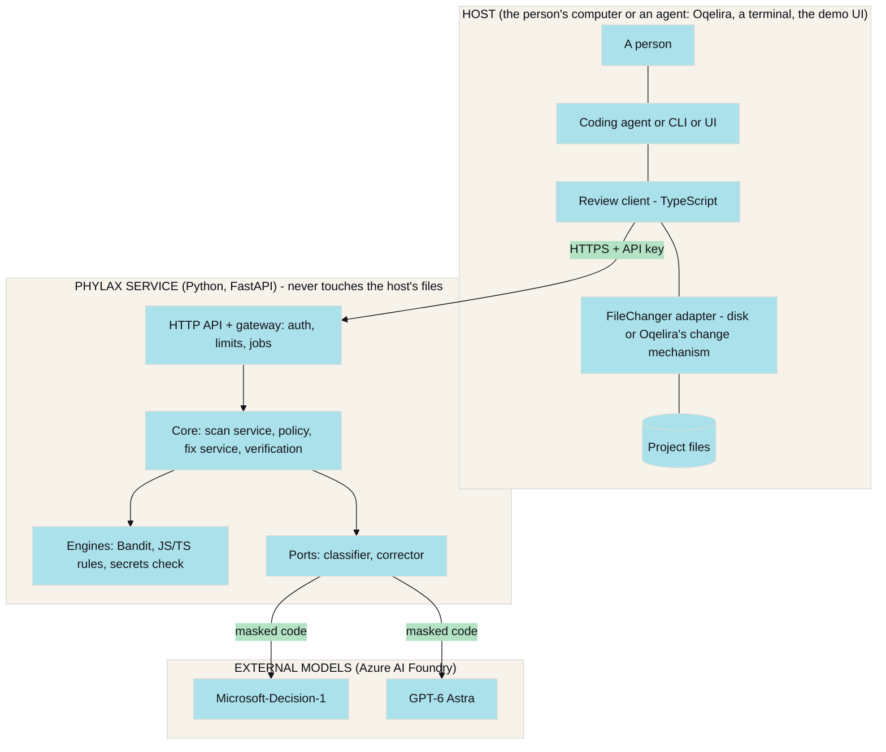
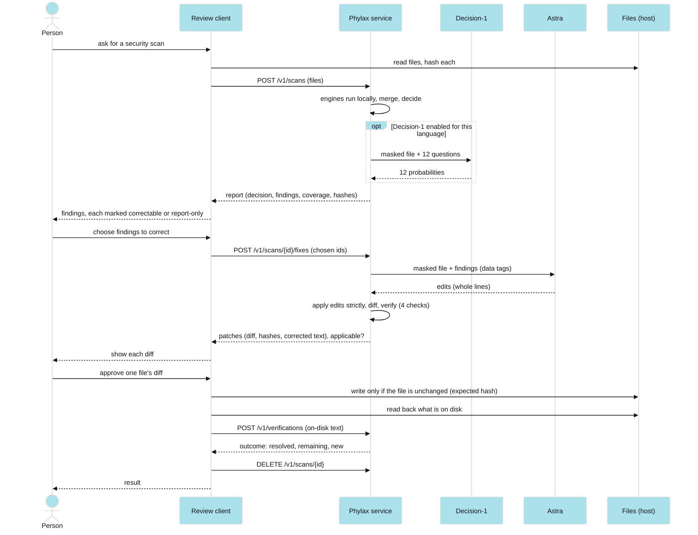

*PHYLAX · TECHNICAL ARCHITECTURE*

# How the pieces fit.

This document describes the components, the interfaces between them, the data that flows, and the boundaries that keep the system safe. It separates the **intended workflow** (the thirteen steps the project set out to build) from the **current implementation**, step by step. Read the status labels in `PHYLAX_PROJECT_OVERVIEW.md` first.

## 1. System context

Three trust zones. The **host** owns the files and the approval. The **service** owns the analysis and holds the Azure credentials (they stay in the service's environment; the host never sees them). The **external models** receive only masked text.

## 2. Components

### 2.1 The service (`security_service/`, about 10,000 lines of Python)

| Module | Responsibility |
|---|---|
| `api/app.py` | FastAPI app: translates HTTP to the gateway and back |
| `api/gateway.py` | every rule of the HTTP service in plain Python: a fixed order of checks, jobs, idempotency, waiting, the fix and verification flows |
| `api/auth.py` | API keys with scopes (`scan`, `fix`, `read`), constant-time comparison |
| `api/ratelimit.py` | per-caller rolling window; fix requests have a stricter, separate limit |
| `api/jobs.py` | in-memory job store: ownership, idempotency, retention, deletion with children |
| `core/scan_service.py` | the pipeline: prepare files, run engines, tag, merge, decide, report |
| `core/policy.py` | the decision function (pure, no model) |
| `core/schema.py` | findings, report, coverage, provenance, and the fix-eligibility rule |
| `core/files.py` | language detection, limits, skips, hashes, line endings |
| `core/redaction.py` | masking (liberal) and secret detection (careful) |
| `core/questions.py` | the 12 questions per language family and their wording |
| `core/fix_service.py` | from findings to a verified, never-applied correction |
| `core/patching.py` | strict edit application, unified diffs, strict diff application |
| `core/verification.py` | the four checks and the outcome |
| `core/errors.py` | stable machine-readable error codes; nothing internal leaks |
| `adapters/bandit.py` | the Python rules engine |
| `adapters/js_rules.py` | original JavaScript and TypeScript rules on tree-sitter |
| `adapters/secrets_check.py` | deterministic secrets detection |
| `adapters/classifier_detector.py`, `decision1.py` | turn Decision-1's probabilities into findings; the Foundry call |
| `adapters/foundry_corrector.py`, `foundry_chat.py` | Astra as the corrector; the chat call |
| `adapters/llm_detector.py`, `foundry_llm.py`, `llm_clients.py` | a generative detector and its clients (**not in the pipeline**) |
| `adapters/fakes.py` | scripted stand-ins used by tests |
| `ports/` | the four interfaces: analyzer, classifier, corrector, LLM |
| `config.py` | every setting, read from the environment; validation and warnings |

### 2.2 Architecture style

A **ports-and-adapters** (hexagonal) design. The core talks only to four interfaces (an analyzer returns findings for code; a classifier returns probabilities for named questions; a corrector returns a patch for findings; an LLM returns JSON for a prompt). Providers are adapters, so a model can be replaced by a new adapter that passes the same conformance tests, without changing the contract. The development notes also planned a role-to-provider registry in YAML; **that was not built**: configuration is environment variables and constants in code.

### 2.3 The review client (`clients/typescript`, package `phylax-review`)

Status: implemented; 79 tests, including end to end against the real Python service (with a stand-in correction model).

| Piece | Responsibility |
|---|---|
| `HttpPhylaxApi` | the contract over HTTP: idempotent retries with the same key, `Retry-After`, polling, https-only for remote hosts, the key only in the `Authorization` header |
| `SecurityReview` | the workflow: `scan`, `proposeCorrections`, `applyProposal`, `verify`, `runInteractive`; batches by the service's limits; deletes scans after |
| `FileChanger` (interface) | the host's way to read, hash and change files |
| `Approver` (interface) | how a person's yes is obtained |
| `DiskFileChanger` | atomic, hash-checked writes of the exact bytes |
| `OqeliraFileChanger` | uses Oqelira's own change mechanism (`changes.mjs`), supplied by the host; the package never imports it |
| CLI `phylax-review` | an interactive terminal flow with **no option that answers yes for the user**; the key only from the environment |
| agent tools (`createSecurityTools`) | `security_scan` (read-only), `security_propose` (asks for corrections for chosen findings), `security_apply` (one correction by id); they cannot be built without declaring how consent is obtained |

The tools are host-neutral definitions. **Mapping them onto Oqelira's own tool type is not done**: it needs Oqelira's tool and approval definitions, which the team has not yet supplied.

### 2.4 The UI (`clients/ui`)

Status: implemented as an **offline demo**. It replays data recorded from the real pipeline (validated against the OpenAPI contract) with the correction model played by a stand-in. A **live mode** (the same screen talking to the real service and a real folder) is **not built**; the screen reads its data through one swappable backend object so that it can be added later without changing any screen. It enforces the same consent rule: applying happens only from the "Apply correction" button.

## 3. Data model

The contract is `openapi.yaml` (OpenAPI 3.1, contract version 1.4.0), and changes within `/v1` are additive only.

- **Finding:** `id`, `path`, `line` (null for a whole-file model finding), `vulnerability_type` (one of 12 plus hardcoded credentials and `other`), `severity` (info, low, medium, high, critical), `confidence` (low, medium, high), `evidence_tier` (`static_rule`, `model_suspicion`, `corroborated`), `sources`, `rule_id`, `cwe`, `evidence` (masked), `description`, `recommendation`, and `fix` (`eligible`, `reason`).
- **ScanReport:** `status`, `decision` (`pass`, `review_required`, `block`, `scan_failed`), `risk_level`, `findings`, `summary` (counts), `decision_reasons`, `coverage`, `provenance`, `duration_ms`.
- **Coverage:** `languages`, `files_scanned`, `scanned_files` (path and SHA-256 of the text as submitted), `skipped_files`, `analyzers_run`, `analyzers_failed`, `not_assessable`.
- **Patch:** `path`, `finding_ids`, `explanation`, `unified_diff`, `base_sha256`, `corrected_content`, `corrected_sha256`. The hashes and full corrected text let a host apply the correction exactly and refuse to overwrite a file that changed since the scan.
- **Verification:** `outcome` (`passed`, `failed`, `inconclusive`), `checks` (scope, syntax, patch_size, rescan, each with a result and a detail), `new_findings`, `resolved_finding_ids`.
- **Fix:** `patches`, `verification`, `applicable`, `failure_reason`, `unfixed` (each unfixed finding with a reason).

## 4. The intended workflow against the implementation

The project's intended workflow has thirteen steps. This table says what exists.

| # | Intended step | Implementation | Status |
|---|---|---|---|
| 1 | Oqelira selects the relevant files | The review client accepts a selection (the project, or named files) from whatever host drives it. The agent-tool wrapper exists but is **not mapped onto Oqelira's tool system** | partly: client yes, Oqelira wiring no |
| 2 | The review client talks to the service over HTTP | `HttpPhylaxApi` | implemented, tested against the real service |
| 3 | The service receives the code | `POST /v1/scans`; limits 50 files, 200 KB per file, 1 MB total; held in memory, 24-hour retention, `DELETE` purges | implemented |
| 4 | Sensitive information is masked | **Differs.** Masking happens where code leaves the system: inside the Decision-1 and Astra adapters, and in every evidence line. The local engines read the raw text in-process. Secrets are detected on the original text locally, and never sent raw to a model | implemented, as a boundary control, not an ingestion step |
| 5 | Static and AI-assisted analysis | Bandit (Python), our rules (JS/TS), the secrets check always; Decision-1 optional and only for validated languages (Python) | implemented; Decision-1 tested with the real model for Python only |
| 6 | The decision engine evaluates findings | `core/policy.py` | implemented |
| 7 | Findings are returned | the report, with coverage and provenance | implemented |
| 8 | If requested, Astra proposes a correction | `POST /v1/scans/{id}/fixes`, off unless enabled, paid per call, rate-limited | implemented; real Astra only on about six Python examples |
| 9 | The corrected code is verified | `FixService` then `VerificationService`: four checks | implemented |
| 10 | The user reviews the diff | in the client: terminal, the demo UI, or the tool consent callback | implemented |
| 11 | Explicit human approval before applying | the `Approver` interface; no skip option anywhere | implemented |
| 12 | The modified files are reread and checked | after applying, the client reads what is **on disk** and calls `POST /v1/verifications` with it | implemented |
| 13 | A final security scan verifies the result | the verification includes a **re-scan of the changed files with the same engines**. A full re-scan of the whole project is the person's choice ("scan again"), not automatic | implemented for changed files; full-project re-scan is manual |

## 5. Sequence

## 6. The HTTP API

| Method and path | Purpose |
|---|---|
| `POST /v1/scans` | submit files; `Prefer: wait=N` returns the result inline if it finishes in time (never more than the configured maximum), otherwise 202 and a poll |
| `GET /v1/scans/{id}` | status and, when finished, the report |
| `DELETE /v1/scans/{id}` | purge the scan, the stored code and its children |
| `POST /v1/scans/{id}/fixes` | ask for corrections for chosen findings of a finished scan |
| `GET /v1/fixes/{id}` | the patches and verification outcome |
| `POST /v1/verifications`, `GET /v1/verifications/{id}` | verify a correction the **caller** produced against an earlier scan (no model needed) |
| `GET /v1/capabilities` | languages, limits, versions, which features are on |
| `GET /healthz`, `GET /readyz` | liveness; readiness (readiness runs a tiny real scan with Bandit, at most every 30 seconds, because it starts a subprocess) |

**Fixed order of checks** for an authenticated operation (the order is part of the design): (1) valid key, 401, so an unauthenticated caller learns nothing; (2) scope, 403; (3) rate limit, 429; (4) body size, 413; (5) valid JSON matching the contract, 400; (6) a request the scanner accepts, 400, 413 or 422, so a bad request is answered at once and never becomes a failed job; (7) the work is queued, and a retry with the same `Idempotency-Key` returns the original job. Fixes and verifications follow the same order, need a **completed scan of the same caller**, and live as long as their scan. Another caller's scan is reported as "not found".

Errors use stable machine codes and a problem-details body (`title`, `status`, `code`, `request_id`). Responses, errors and log lines never contain submitted code, a key, or a provider message.

Concurrency: scans run in a bounded worker pool; a fix has its own small pool and a stricter rate limit, so slow, paid model calls cannot starve ordinary scans.

## 7. Error handling and failure scenarios

| Scenario | Behaviour |
|---|---|
| Bandit crashes, times out (30 s) or prints unreadable output | engine failure for that file; the report lists it; a PASS is impossible under strict coverage |
| An engine raises an exception | caught; only the exception *type* is recorded (a message could contain code); counted as a failure |
| A JavaScript or TypeScript file does not parse | engine failure, never a pass |
| Decision-1 unreachable, rejects the request, or the file is too large | optional engine: the scan finishes on the others with a note; required engine (`CLASSIFIER_REQUIRED`): the scan fails |
| A source file is unsupported, too large, or invalid | skipped with a reason; blocks a PASS |
| No file at all could be scanned | REVIEW_REQUIRED if source files were skipped; PASS "nothing was checked" if there were none |
| Astra unavailable, or its answer is unusable | the finding is listed under `unfixed` with the reason; nothing half-applied |
| An edit does not match the file exactly, or overlaps | the whole proposal for that file is refused |
| The patch fails verification | returned for review with `applicable: false` |
| The file changed on disk after the scan | the client refuses to apply (expected hash mismatch) and does not even offer it |
| The host and the service disagree on a file's hash | the review stops before anything could be written |
| The service restarts | scans are lost (memory only); a client treats "not found" as "scan again" |
| Rate limit (429) | the client waits for `Retry-After` and retries with the same idempotency key |
| The agent tool's consent is not declared | the tools cannot be created |

## 8. Security boundaries and controls

| Boundary | What crosses it | Controls |
|---|---|---|
| Host to service | file text; an API key | key only in the `Authorization` header; scoped keys; per-caller rate limits; size limits; https-only to remote hosts in the client; the key is never accepted on a command line |
| Service to external models | masked text only | masking inside each model adapter; random per-request tag names around code; the model told the text is data; secrets never in the questions; errors never echo code |
| Service to host | findings, diffs, hashes, corrected text | the service has **no endpoint that writes a file**; evidence lines are masked; corrected text is returned only for patches the client will apply |
| Host to files | the person's approval | the client applies only after an explicit yes for that file's diff, only if the file is unchanged, atomically, and reads the result back |
| Untrusted code to the analyzers | code under review | code is never executed; Bandit runs in a subprocess with a timeout in a throwaway directory with `--ignore-nosec`; rules read structure not comments |

Residual risks, stated: prompt injection can lower model scores (measured, section 4.6 of the algorithm guide); masking is best-effort and a secret in an unusual format may slip through; Bandit's subprocess has no memory or network limit yet; the model providers' data terms and regions apply to masked code (Astra is offered in Foundry only as a Global or US Data Zone deployment, which matters if a customer needs EU-only processing; this question was raised and not resolved); the service has no built-in TLS (the hosting platform provides it).

## 9. Deployment

A container image is defined (`Dockerfile`: a pinned Python base, exact pinned packages, a non-root user, a health check, no secrets baked in) and published to the GitHub Container Registry by a workflow that **starts the image and runs a smoke test against it before publishing**. CI runs the whole suite on each push. The production settings enable corrections (with a strict rate limit) and Decision-1 for Python only. **It is not deployed to Azure**: that step was put on hold; the guide for it is written and untested. The service must run as **one instance** because scans are kept in memory.

## 10. Configuration

All in environment variables (`config.py` lists every one; the service refuses to start without an API key): `SERVICE_API_KEYS` (name, scopes, key), `FOUNDRY_ENDPOINT` and `FOUNDRY_API_KEY`, `DECISION1_DEPLOYMENT`, `CORRECTOR_DEPLOYMENT`, `CLASSIFIER_ENABLED`, `CLASSIFIER_THRESHOLD` (default 0.70), `CLASSIFIER_REQUIRED`, `CLASSIFIER_LANGUAGES` (default `python`), `SERVICE_FIXES_ENABLED`, rate limits and worker counts, retention hours, and the maximum wait.

## 11. Known limitations of the architecture

Memory-only storage and a single instance; no persistence, no horizontal scaling. No cross-function or cross-file analysis. No chunking for large files. The generative-detector path exists but is unused. Verification checks safety and syntax, not behaviour. The Oqelira tool mapping, the UI's live mode, and the Azure deployment are not done. Several originally planned items were dropped or changed (see the overview's table of differences).
